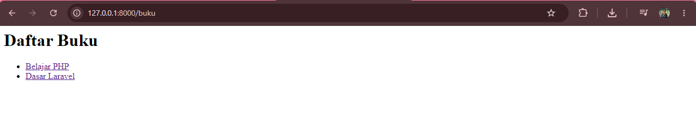
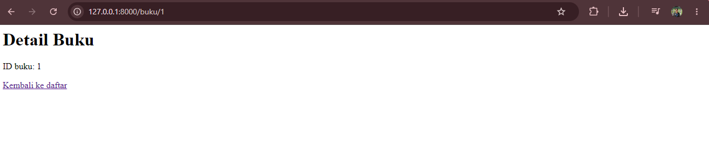
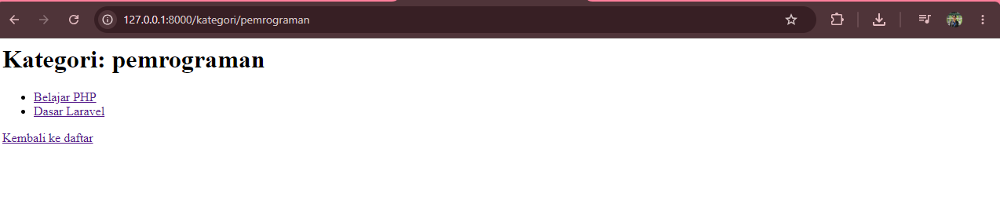
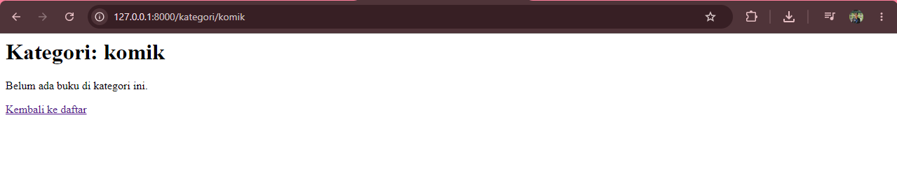

# Tugas Rumah Pertemuan 7: Pemrograman Berorientasi Objek

Nama: Rizki Maulana
NIM: 20251020046

## Halaman yang ditambahkan
Halaman kategori buku di `/kategori/{nama?}`. Parameter `nama` bersifat
opsional: `/kategori` menampilkan semua buku, sedangkan
`/kategori/novel` memfilter buku berdasarkan kategori.

## Cara menjalankan
1. Jalankan `composer install`
2. Salin `.env.example` menjadi `.env`, lalu `php artisan key:generate`
3. Jalankan `php artisan serve`
4. Buka http://127.0.0.1:8000/kategori/pemrograman

## Alur Route -> Controller -> Blade
1. Route `/kategori/{nama?}` di `routes/web.php` memanggil
   `BukuController@kategori`.
2. Controller memfilter data buku (array contoh) berdasarkan `$nama`,
   lalu mengirim `nama` dan `daftarBuku` ke view `buku.kategori`.
3. Blade (`resources/views/buku/kategori.blade.php`) menampilkan hasilnya:
   `@if` untuk kondisi data kosong dan `@foreach` untuk menampilkan daftar.

## Screenshot

